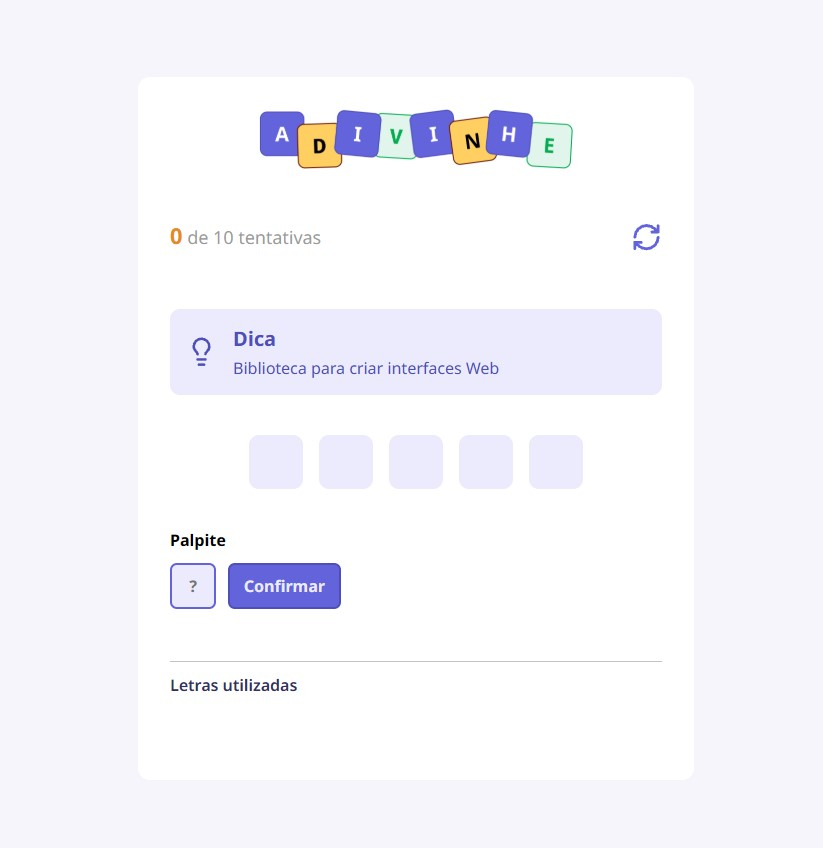

# Adivinhe

<p align="center">
  
</p>

> [!TIP]

Jogo de adivinhação em que o jogador precisa descobrir uma palavra relacionada a tecnologia. Para cada rodada, uma dica é exibida na tela e o usuário deve informar uma letra por vez até completar a palavra ou esgotar as tentativas.

## Sobre o jogo

- Uma palavra aleatória é escolhida a partir da lista de desafios.
- O jogo mostra uma dica para ajudar a identificar a palavra.
- O usuário digita uma letra por vez.
- Letras corretas são reveladas nas posições correspondentes.
- Letras já utilizadas são exibidas na seção **Letras utilizadas**.
- Ao descobrir todas as letras, uma mensagem de vitória aparece.
- Se o limite de tentativas terminar, o jogador perde a rodada.
- É possível reiniciar o jogo manualmente ou iniciar uma nova rodada após vencer ou perder.

O número máximo de tentativas é a quantidade de letras da palavra mais cinco tentativas adicionais.

## Tecnologias utilizadas

- **HTML5** - estrutura da aplicação.
- **CSS3** - estilização global e layout.
- **CSS Modules** - estilos isolados por componente.
- **React 19** - criação dos componentes e gerenciamento de estado.
- **TypeScript** - tipagem estática e segurança no código.
- **Vite** - servidor de desenvolvimento e empacotamento da aplicação.
- **Google Fonts** - fonte Noto Sans utilizada na interface.

## Funcionalidades

- Geração aleatória de palavras.
- Dicas diferentes para cada desafio.
- Controle do número de tentativas.
- Validação de letras vazias.
- Bloqueio de letras repetidas.
- Contagem de acertos e tentativas.
- Identificação visual das letras utilizadas.
- Reinício de partida por meio de confirmação.
- Reinício automático ao finalizar uma rodada.

## Estrutura do projeto

```text
src/
├── assets/                 # Imagens e ícones
├── components/
│   ├── Button/             # Botão de confirmação
│   ├── Header/             # Logotipo, tentativas e reinício
│   ├── Input/              # Campo para digitar a letra
│   ├── Letter/             # Caixa de cada letra da palavra
│   ├── LettersUsed/        # Histórico de letras utilizadas
│   └── Tip/                # Exibição da dica
├── utils/
│   └── words.ts            # Lista de palavras e dicas
├── App.tsx                 # Estado e regras do jogo
├── app.module.css          # Estilos da página principal
├── global.css              # Estilos globais
└── main.tsx                # Ponto de entrada React
```

### Ambiente de desenvolvimento

```bash
npm run dev
```
